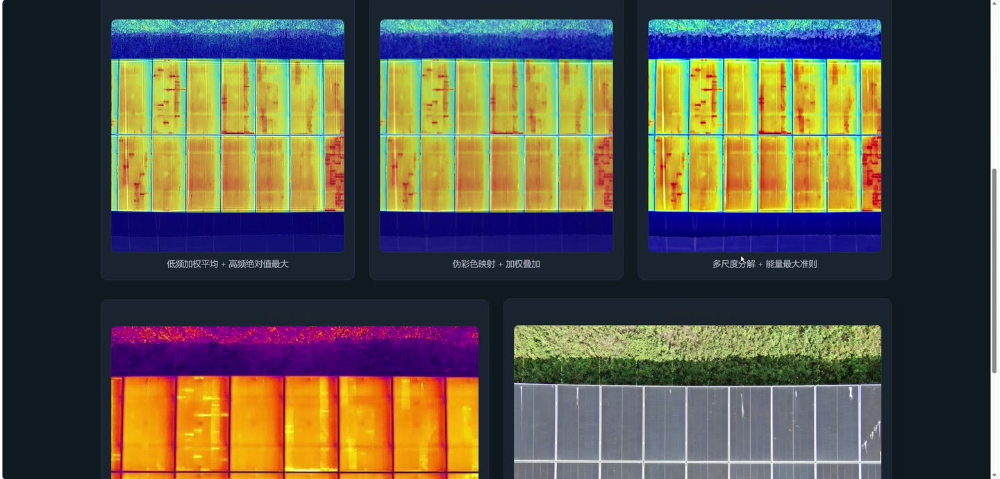
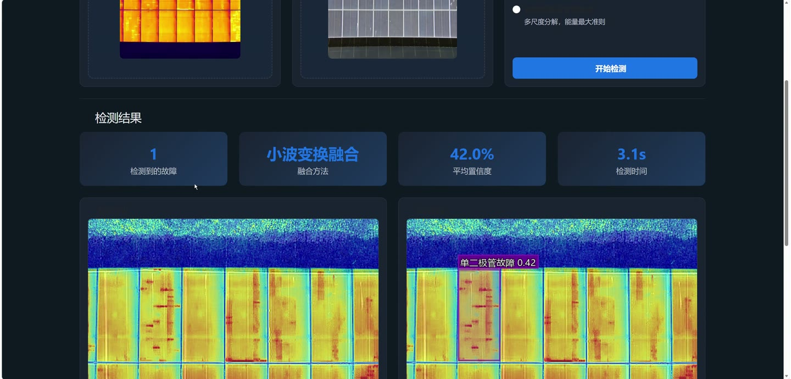
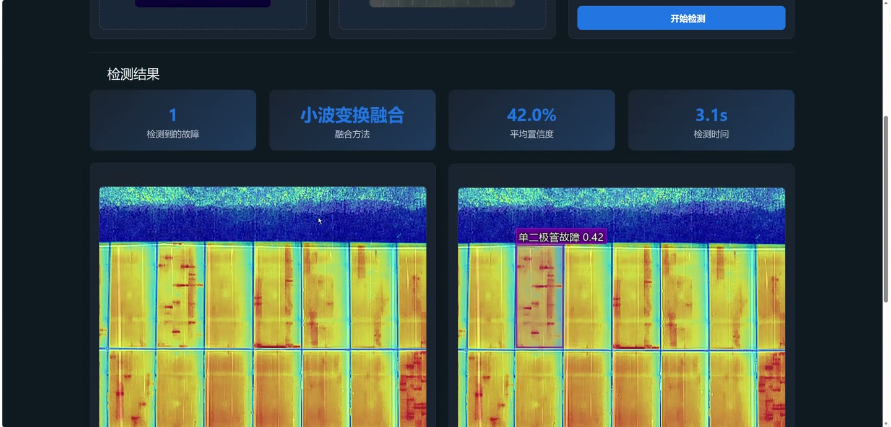
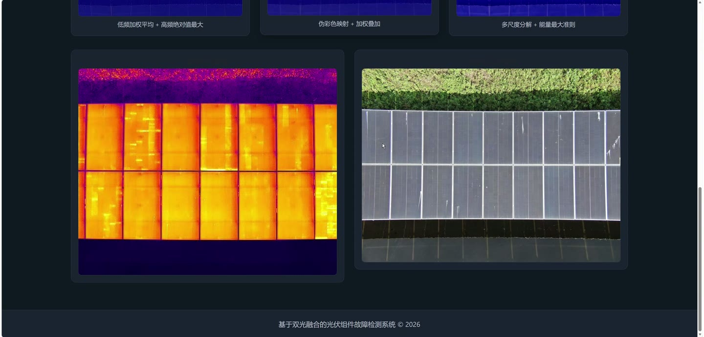
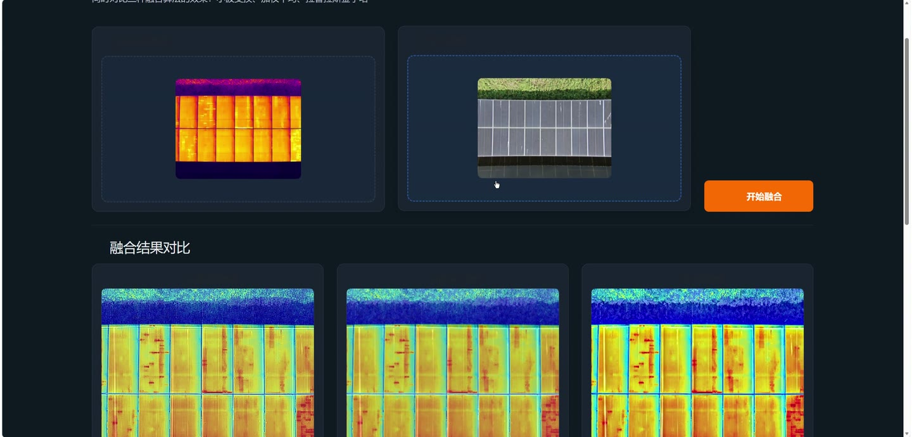
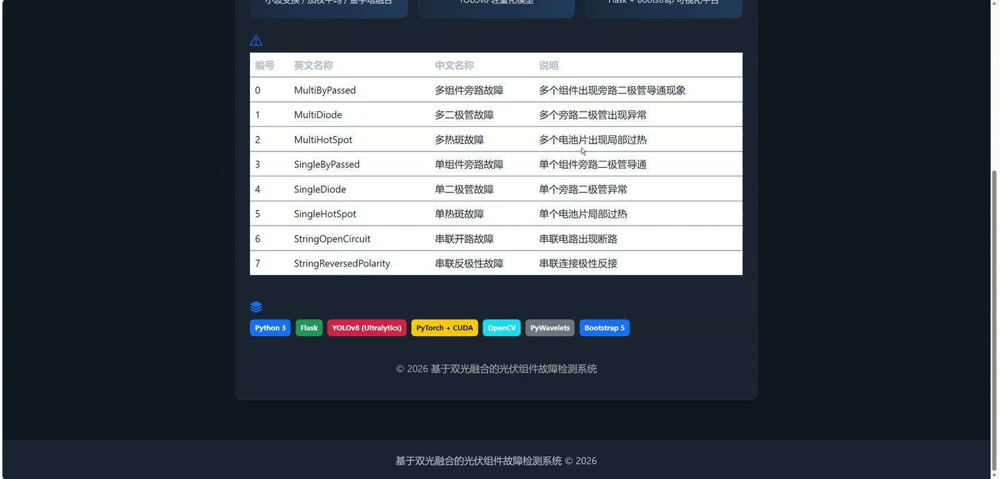

# (附文档)Python+Flask+YOLO 基于双光融合的光伏组件故障检测

**技术栈**：Python、Flask、PyTorch、YOLO、深度学习

### 系统简介

本系统是一套基于双光融合的光伏组件故障检测平台，采用 Flask 后端与前端模板渲染相结合的方式构建。系统通过红外图像与可见光图像配准融合，结合 YOLO 深度学习模型对光伏组件进行故障识别，支持多种融合算法切换、检测历史管理与融合效果对比分析，涵盖普通用户端与管理员端两类角色。
 
### 核心功能
 
### 普通用户端

 
- 上传红外图像：在检测页选择红外图像文件，作为故障检测的基础输入。 
- 选传可见光图像：可选上传可见光图像，系统自动与红外图像进行配准融合。 
- 选择融合方法：支持小波变换融合、加权平均融合、拉普拉斯金字塔融合三种方式切换。 
- 图像自动配准：将可见光图像对齐到红外坐标系，统一缩放至 640×640 并返回配准信息。 
- 执行故障检测：调用 YOLO 模型以 conf=0.25、iou=0.3 参数对融合图像进行推理。 
- 查看检测结果图：在结果图上绘制半透明填充框、粗边框与中英文标签，支持标签防重叠。 
- 查看检测明细：展示每个故障的类别中英文名称、置信度与边界框坐标。 
- 查看故障总数：统计并展示本次检测识别出的故障目标数量。 
- 浏览检测历史：在历史页面按时间倒序查看最近 100 条检测记录。 
- 查看融合演示：在融合演示页面对比不同融合算法的处理思路与效果。 
- 查看对比分析：在对比页面查看各数据集 Precision、Recall、mAP50、mAP50-95 指标。 
- 查看指标卡片：以进度条形式对比红外基线方案与当前融合方案的指标差异与提升幅度。
 
### 管理员端

 
- 管理检测历史：通过接口获取全部历史记录，支持按结构查看任务编号、时间戳与融合方法。 
- 清空历史记录：调用清空接口一键删除全部检测历史数据。 
- 维护故障类别：内置 8 类故障中英文对照表，涵盖多组件旁路、多二极管、多热斑、单组件旁路、单二极管、单热斑、串联开路、串联反极性。 
- 配置融合算法：维护加权平均、小波变换、拉普拉斯金字塔三种融合算法的思路与效果说明。 
- 加载检测模型：按候选路径自动查找 best.pt 权重，未找到时回退加载预训练模型。 
- 查看对比指标：读取 comparison_metrics.csv，解析基线行与当前融合行并计算各项指标差值。 
- 查看相对提升：计算并展示各指标相对基线的百分比变化与趋势方向。 
- 训练检测模型：运行训练脚本加载融合数据集，按 100 轮、640 尺寸、batch 16 训练 YOLOv8n。 
- 验证模型效果：训练完成后在测试集上验证并输出 mAP50 与 mAP50-95 结果。
 
### 技术栈

 后端框架Python + Flask 深度学习框架PyTorch + Ultralytics YOLOv8 检测模型YOLOv8n（轻量化） 图像处理OpenCV + NumPy + Pillow 融合算法小波变换融合、加权平均融合、拉普拉斯金字塔融合 图像配准自定义配准模块 前端模板Flask Jinja2 模板（index、history、fusion_、comparison） 数据存储JSON 历史文件 + CSV 对比指标文件 接口风格RESTful JSON 接口
 
### 交付内容

 
- 后端完整源码 
- 前端完整源码 
- 数据库初始化脚本 
- 万字文档

## 界面展示

---

## 获取完整源码 + 万字文档

本仓库为项目介绍页。**完整前后端源码、数据库初始化脚本、万字项目文档**，请加微信 `kangkangcode`，或访问 [codekk.top](http://codekk.top) 获取。

可作课程设计 / 毕业设计参考，支持远程部署调试。